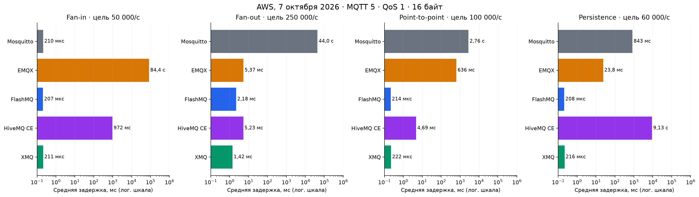
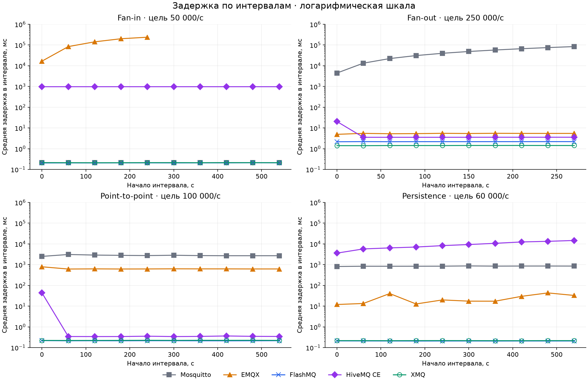

# Five MQTT brokers on AWS: latency, CPU and memory under the same load

How many messages per second can an MQTT broker handle? Without describing the load the question
means nothing: accepting messages from 50 thousand devices, fanning one message out to a thousand
subscribers, and holding half a million connections stress a server in different ways.

I ran Mosquitto, EMQX, FlashMQ, HiveMQ CE and XMQ through five identical scenarios on the same pair
of AWS machines. For each broker the records include latency, CPU and memory in per-minute intervals —
including where a broker failed to keep up.

Disclosure: I am the developer of XMQ, and the load generator `xmq_scn` is from the same project. All
versions, configurations and full reports are open: the results can be verified and reproduced.

## At a glance

Average latency per scenario; † — the broker did not hold the target rate.

| Broker | Connections | Fan-in | Fan-out | Point-to-point | Persistence |
|---|---:|---:|---:|---:|---:|
| Mosquitto 2.1.2 | 1.0 ms | 210 μs | 44 s † | 2.76 s | 843 ms |
| EMQX 6.3.1 | 720 μs | 84 s † | 5.4 ms | 636 ms | 23.8 ms |
| FlashMQ 1.27.2 | 347 μs | 207 μs | 2.2 ms | 214 μs | 208 μs |
| HiveMQ CE 2026.5 | 4.1 ms | 972 ms | 5.2 ms | 4.7 ms | 9.1 s |
| XMQ 0.9.20 | 340 μs | 211 μs | 1.4 ms | 222 μs | 216 μs |

FlashMQ and XMQ completed every scenario with sub-millisecond latency (fan-out ~2 ms). Mosquitto is
strongest where one core is enough. EMQX and HiveMQ CE hold most of the loads but pay for it in latency
and resources.

## The scenarios

Taken from the [Open MQTT Benchmark Suite](https://github.com/emqx/mqttbs) by the EMQX team and their
[comparison of EMQX and Mosquitto](https://www.emqx.com/en/blog/open-mqtt-benchmarking-comparison-emqx-vs-mosquitto)
(April 2023): fan-in, fan-out, point-to-point and connections, with the Enterprise Set parameters.
Similar load types are also used by [HiveMQ](https://www.hivemq.com/blog/cracking-mqtt-performance-automation-part-2-benchmarking/).

What differs from the original article:

- every scenario is MQTT 5, 10 minutes each (fan-out: 5) instead of 30;
- point-to-point at 100,000 msgs/s instead of 50,000;
- 500,000 connections instead of 1,000,000, at a rate of 5,000/s;
- a persistence scenario was added;
- the server is c5n.4xlarge instead of c5.4xlarge, the generator is `xmq_scn` instead of XMeter.

This is the same scenarios applied to current broker versions, not a reproduction of the 2023
experiment. The numbers from that article are not used here.

## The bench

The broker and the generator run on separate EC2 c5n.4xlarge instances (16 vCPU: 8 cores × 2 threads)
in the same placement group, Ubuntu 26.04, kernel 7.0.0-1013-aws, no CPU pinning. The broker is
restarted before each scenario; no other broker runs at the same time. Messages: QoS 1, payload 16
bytes.

Each broker was configured for high load, not taken as-is from the defaults:

- **Mosquitto:** `max_queued_messages 0`, `max_inflight_messages 65534`. A value of 0 in Mosquitto
  2.1 leaves the input quota at zero, and the broker writes a warning for every message — that run
  filled the server's disk and was repeated.
- **EMQX:** `force_shutdown.max_mailbox_size` and `max_mqueue_len` raised to 100,000 (the default of
  1,000 saw subscribers disconnected and messages dropped), `max_inflight 128`.
- **FlashMQ:** 16 worker threads.
- **HiveMQ CE:** JVM `-Xms2g -Xmx20g -XX:MaxDirectMemorySize=5g`.
- **XMQ:** 3 send, 4 receive and 2 delivery threads.

More about the bench setup is on [the XMQ site](https://xmq.sptk.net/xmq_tests_environment), together
with the interactive graphs of this series.

## How to read the numbers

- **Latency** — from the publish call to the subscriber's receipt. The tables give the mean over the
  whole run, including the ramp-up; the graphs give the mean inside each interval. No percentiles are
  reported.
- **CPU** — percent of one hardware thread: 400% means four busy vCPUs out of 16.
- **Memory** — peak RSS of the broker process.
- The generator pairs receipts with sends in FIFO order, not by message id. While delivery is
  lossless this is accurate; when the broker drops messages the latency estimate is inflated. This
  matters for EMQX in fan-in.

## 500,000 connections

500,000 clients connect at 5,000/s; latency is the connect time.

| Broker | Mean | Median of intervals | CPU, mean | Peak RSS |
|---|---:|---:|---:|---:|
| Mosquitto | 1004 μs | 316 μs | 18% | 2.41 GB |
| EMQX | 720 μs | 712 μs | 359% | 10.06 GB |
| FlashMQ | 347 μs | 327 μs | 33% | 2.13 GB |
| HiveMQ CE | 4088 μs | 3477 μs | 107% | 4.06 GB |
| XMQ | 340 μs | 338 μs | 52% | 1.27 GB |

All five accepted every connection. Mosquitto, FlashMQ and XMQ connect a client in ~0.3 ms; one
interval of 7.2 ms dragged Mosquitto's mean up. Single-threaded Mosquitto uses the least CPU; XMQ
uses the least memory.

## Fan-in: 50,000 publishers, one shared subscription

50,000 publishers send one message per second, each to its own topic. 500 subscribers share the
stream through `$share/benchmark/test/#`. The target is 50,000 deliveries/s.

| Broker | Delivered/s | Mean latency | CPU, mean | Peak RSS |
|---|---:|---:|---:|---:|
| Mosquitto | 49992 | 210 μs | 88% | 258 MB |
| EMQX | 1613 † | 84 s | 965% | 12.85 GB |
| FlashMQ | 49992 | 207 μs | 221% | 246 MB |
| HiveMQ CE | 49908 | 972 ms | 185% | 1.91 GB |
| XMQ | 49992 | 211 μs | 228% | 192 MB |

Mosquitto, FlashMQ and XMQ are indistinguishable in latency: 50,000 msgs/s is a modest load for
them. Mosquitto spends the least CPU, XMQ the least memory.

HiveMQ CE keeps the rate but the latency hovers near a second — likely an artefact of buffering in the
shared subscription; this test does not establish the cause.

EMQX hits the CPU wall: 16 cores deliver 1–3.5 thousand msgs/s out of 50,000. Subscriber queues grow
until their processes exceed `force_shutdown.max_heap_size` (48 MB) — then EMQX closes the subscribers
along with their queues. Delivery stops after about five minutes: out of 30 million messages sent,
484,000 were received. Raising the heap limit could have been tried, but it would not have raised the
delivery rate — the latency would have kept growing.

## Fan-out: one message to a thousand subscribers

5 publishers send 50 msgs/s each to 5 topics; 1,000 subscribers receive everything: 250 publications
become 250,000 deliveries/s. 5 minutes, 1,005 connections.

| Broker | Delivered/s | Mean latency | CPU, mean | Peak RSS |
|---|---:|---:|---:|---:|
| Mosquitto | 176577 † | 44 s | 100% | 73 MB |
| EMQX | 249972 | 5.4 ms | 1491% | 617 MB |
| FlashMQ | 249993 | 2.2 ms | 567% | 28 MB |
| HiveMQ CE | 249890 | 5.2 ms | 1068% | 1.58 GB |
| XMQ | 249993 | 1.4 ms | 376% | 45 MB |

XMQ is fastest here and uses the least CPU among the brokers that held the rate; FlashMQ is the most
memory-efficient. Mosquitto hits the single-core limit: 177,000 deliveries/s, and the latency climbs
from 4 to 84 seconds over the 5 minutes. For HiveMQ CE only the first interval is slow (20 ms); after
that it settles at ~3.5 ms.

## Point-to-point: 100,000 messages per second

50,000 publisher-subscriber pairs, each on its own topic, 2 msgs/s per pair: 100,000 connections and
100,000 deliveries/s.

| Broker | Delivered/s | Mean latency | CPU, mean | Peak RSS |
|---|---:|---:|---:|---:|
| Mosquitto | 99449 | 2.76 s | 97% | 615 MB |
| EMQX | 99700 | 636 ms | 1503% | 4.93 GB |
| FlashMQ | 99915 | 214 μs | 448% | 493 MB |
| HiveMQ CE | 99862 | 4.7 ms | 1046% | 2.83 GB |
| XMQ | 99913 | 222 μs | 429% | 387 MB |

All five hold the rate; not all hold the latency. FlashMQ and XMQ are at ~0.2 ms. HiveMQ CE after the
first minute (44 ms) works at 340–363 μs — probably JVM warm-up. EMQX holds 0.6 s on 15 cores,
Mosquitto 2.7 s on one.

Interactive versions of these graphs, together with per-interval memory use, are [on the XMQ
site](https://xmq.sptk.net/xmq_tests_fanin).

## Persistence: 60,000 msgs/s with persistent sessions

60,000 pairs with `clean_session=false`, one message per second, 10 minutes. The storage is cleared
before the run. Brokers persist differently, so the method is noted in the table:

| Broker | How it stores | Delivered/s | Mean latency | CPU, mean | Peak RSS |
|---|---:|---:|---:|---:|---:|
| Mosquitto | snapshot at `autosave_interval` | 59844 | 843 ms | 97% | 642 MB |
| EMQX | durable sessions | 59655 | 23.8 ms | 1265% | 5.08 GB |
| FlashMQ | snapshot in `storage_dir` | 59941 | 208 μs | 246% | 587 MB |
| HiveMQ CE | file persistence | 58368 | 9.1 s | 1398% | 22.09 GB |
| XMQ | Redis (AOF, `appendfsync everysec`) | 59933 | 216 μs | 284% | 460 MB |

Mosquitto and FlashMQ take periodic snapshots; EMQX, HiveMQ CE and XMQ write messages. Comparisons
across these lines are therefore not apples-to-apples, and identical latencies for FlashMQ and XMQ
do not mean identical guarantees: on failure, FlashMQ loses everything after the last snapshot. XMQ
on a process crash loses no more than the writes waiting behind its `max_queued_writes` (here 1,000;
at 60,000 msgs/s ~17 ms of stream). When the whole host goes down the `appendfsync everysec` window
of Redis itself adds up to a second. Redis ran on the same host; its CPU and memory are not in the
table.

HiveMQ CE falls behind: latency grows from 3.6 to 14.6 s, memory to 22 GB. EMQX holds the rate at
12–43 ms per interval.

The first EMQX run refused every persistent connection (`Server not available`). Our cleanup script
had deleted the durable storage data but left behind the Mnesia records that pointed to it, and EMQX
waited for replicas that no longer existed. The scenario was re-run on AWS with the same settings
after the cleanup was fixed; the table shows the re-run.

## What this test does not show

One run of each broker–scenario pair, without repetitions or confidence intervals: a difference of a
few microseconds between FlashMQ, Mosquitto and XMQ should not be read as a ranking. The test does
not search for throughput limits — only the behaviour at a given load. Clusters, TLS, large messages,
crash recovery and operational convenience are not compared.

## How to reproduce

The scenarios, the generator, the broker configurations and the full reports of this series are in
the [XMQ repository](https://github.com/alexparshin1/xmq_public) (`LoadTest/`); the generator is
described on the [MQTT Test Suite page](https://xmq.sptk.net/xmq_mqtt_test_suite):

- `500K-Connections-5000-rate.json` — 500,000 connections, 5,000/s
- `Fan-In-50K-500-50K-50K.json` — 50,000 publishers, 500 shared-subscription members, 50,000 msgs/s
- `Fan-Out-5-1000-5-250K-5min.json` — 5 publishers, 1,000 subscribers, 250,000 deliveries/s
- `Point-To-Point-50K-50K-50K-100K.json` — 50,000 pairs, 100,000 msgs/s
- `Point-To-Point-60K-persistent.json` — 60,000 pairs with persistent sessions

Run them on your own hardware or find a flaw in the methodology — open an
[issue](https://github.com/alexparshin1/xmq_public/issues). XMQ can be
[downloaded](https://xmq.sptk.net/downloads) or run in Docker (see the README).