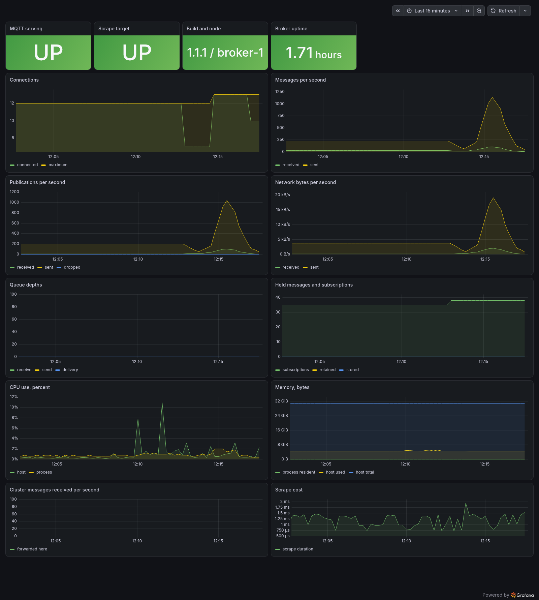

# XMQ, Prometheus, Loki and Grafana

A small stack that shows what the broker exposes, without assembling the monitoring side by hand:

```text
XMQ  metrics (9184)  ->  Prometheus (9090)  ->
                                                 Grafana (3001)
XMQ  logs (stdout)   ->  Alloy  ->  Loki (3100)  ->
```

This is a local demo, not a production-hardened deployment. Published ports bind to
`127.0.0.1` so the anonymous MQTT listener, unauthenticated metrics/Prometheus/Loki endpoints,
and Grafana's demo credentials are not exposed to the LAN. Do not remove that bind address or
publish these services publicly without configuring authentication, TLS and network access first.

## Requirements

- Docker and Docker Compose.
- An XMQ image with the Prometheus endpoint and JSON logs: **1.1.1 or later**. Set `XMQ_VERSION` to
  one that has them; `latest` follows the published image.

## Start

```bash
cd docker/observability
XMQ_VERSION=1.1.1 docker compose up -d
```

Grafana is published on **3001**, not its usual 3000: the XMQ unit tests bind 3000, and a stack
left running would make them fail with "address already in use".

| What | Where | Credentials |
|---|---|---|
| Grafana | http://localhost:3001 | `admin` / `admin`, or `GRAFANA_PASSWORD`; anonymous Viewer access is also enabled |
| Prometheus | http://localhost:9090 | none |
| Loki | http://localhost:3100 | none |
| XMQ configuration interface | https://localhost:18883 | none until the administrator password is set |
| XMQ metrics | http://localhost:9184/metrics | none |
| MQTT | `localhost:1883`, TLS `localhost:8883` | anonymous |

The dashboards are provisioned from `grafana/dashboards/` and appear under the **XMQ** folder:
`xmq-overview.json` is the metrics one, `xmq-logs.json` the logs. Prometheus alert rules are in
`prometheus/xmq-alerts.yml`; the log alert is provisioned by Grafana, in
`grafana/provisioning/alerting/xmq-logs.yml`. Broker-side Prometheus alerts for sustained
persistence backpressure and missing cluster peer links are in
`grafana/provisioning/alerting/xmq-broker.yml`.

What the metrics dashboard looks like on a broker serving traffic:



Anonymous MQTT access is on so the stack works before any account exists. Keep the ports bound to
localhost for this demo. For a network-accessible deployment, set `XMQ_ALLOW_ANONYMOUS=false`,
create accounts in the interface, configure a Grafana password and metrics authentication, and
restrict access to Prometheus and Loki before exposing any ports.

Stop it with:

```bash
docker compose down          # keeps Prometheus and Grafana data
docker compose down -v       # also removes the volumes
```

## Protecting the metrics endpoint

Set a username and password on the **Prometheus** page of the interface. Then add credentials to
`prometheus/prometheus.yml`:

```yaml
    basic_auth:
      username: metrics
      password: "the same secret entered there"
```

and reload the configuration:

```bash
curl -X POST http://localhost:9090/-/reload
```

Scrapes without valid credentials are answered with `401`. The password is stored as a verifier,
not as text; the interface shows it masked.

## Logs

The broker writes one JSON object per line when `XMQ_LOG_FORMAT=json`, which this stack sets. `Alloy`
reads docker's copy of the container's stdout and sends it to Loki with four labels taken from the
object: `level`, `node`, `subject` and `component`. The message stays in the line.

Open **Dashboards -> XMQ -> XMQ logs**:

- records per minute, split by level and by node;
- errors and warnings per minute, by node;
- errors by subject, so a client that cannot authenticate is distinguishable from a cluster link
  that keeps dropping;
- the log itself, filtered by node, level and subject.

The same thing in Explore, if the dashboard is not what you want:

```logql
{job="xmq", level="error"}
{job="xmq", node="broker-2"} |= "certificate"
sum by (subject) (count_over_time({job="xmq", level="error"}[5m]))
```

Loki keeps a week (`retention_period` in `loki/loki.yml`) in the `loki-data` volume. That is a demo
retention, not a recommendation: point Alloy's `loki.write` endpoint at the Loki you already run and
delete the `loki` service if there is one.

Two things to know about the collector:

- It needs `/var/run/docker.sock`, read-only, because that is where docker's copy of the stdout is.
  It never starts or stops anything.
- It selects the broker by its compose service label, `com.docker.compose.service=xmq`. A broker
  run outside compose is not collected - point Alloy at a file with `loki.source.file` instead, or
  keep using whatever ships your container logs already.

The provisioned log and broker alerts are not connected to a receiver: **Alerting -> Contact points**, add one, then point
the **XMQ** notification policy at it. Without a contact point the rule still evaluates and shows in
the Alerting page, it just notifies nobody.

## Connecting your own Grafana

If Prometheus and Grafana are already installed, this stack is not needed. Point your Prometheus at
the broker with the scrape configuration in [`doc/Prometheus.md`](../../doc/Prometheus.md), then
bring the dashboards across.

The dashboards name their data source by UID, not by name: every panel in `xmq-overview.json` asks
for `xmq-prometheus`, and every panel in `xmq-logs.json` for `xmq-loki`. A data source called
"Prometheus" but carrying another UID leaves those panels saying the data source was not found.
Either create it with that UID - **Connections -> Data sources -> Add data source -> Prometheus**,
and set **UID** to `xmq-prometheus` - or provision it from
`grafana/provisioning/datasources/xmq.yml`, which is what this stack uses, with the URLs changed to
your servers.

Then **Dashboards -> New -> Import -> Upload dashboard JSON file**, picking
`grafana/dashboards/xmq-overview.json` - and `xmq-logs.json` if the JSON log lines are collected
too, as described above. The Prometheus alert rules go into your `rule_files` from
`prometheus/xmq-alerts.yml`; the log alert is a Grafana alert rule on the Loki data source, in
`grafana/provisioning/alerting/xmq-logs.yml`. Broker alert rules on Prometheus are in
`grafana/provisioning/alerting/xmq-broker.yml`.

Only Grafana's data source changes: the broker keeps answering the same `/metrics` text and is not
configured to know who scrapes it.

## Health probes

The same listener answers two endpoints that need no credentials, for a load balancer or a
Kubernetes probe:

```bash
curl -i http://localhost:9184/healthz   # 200 {"status":"ok"} while the process is alive
curl -i http://localhost:9184/readyz    # 200 ready, 503 not ready with a reason
```

`/readyz` is `503` while MQTT is stopped or starting, and on a cluster node that does not hold its
lease - the same condition under which the node refuses clients. A Kubernetes probe looks like:

```yaml
livenessProbe:
  httpGet: {path: /healthz, port: 9184}
  periodSeconds: 10
readinessProbe:
  httpGet: {path: /readyz, port: 9184}
  periodSeconds: 5
```

## Is Grafana needed for testing?

No. The broker's tests exercise `/metrics` directly (format, values, authentication, status codes);
Prometheus and Grafana are for people looking at the result. The stack is here to validate the
dashboards and alert rules by eye, and to give a working example to copy from - not as a test
dependency.
